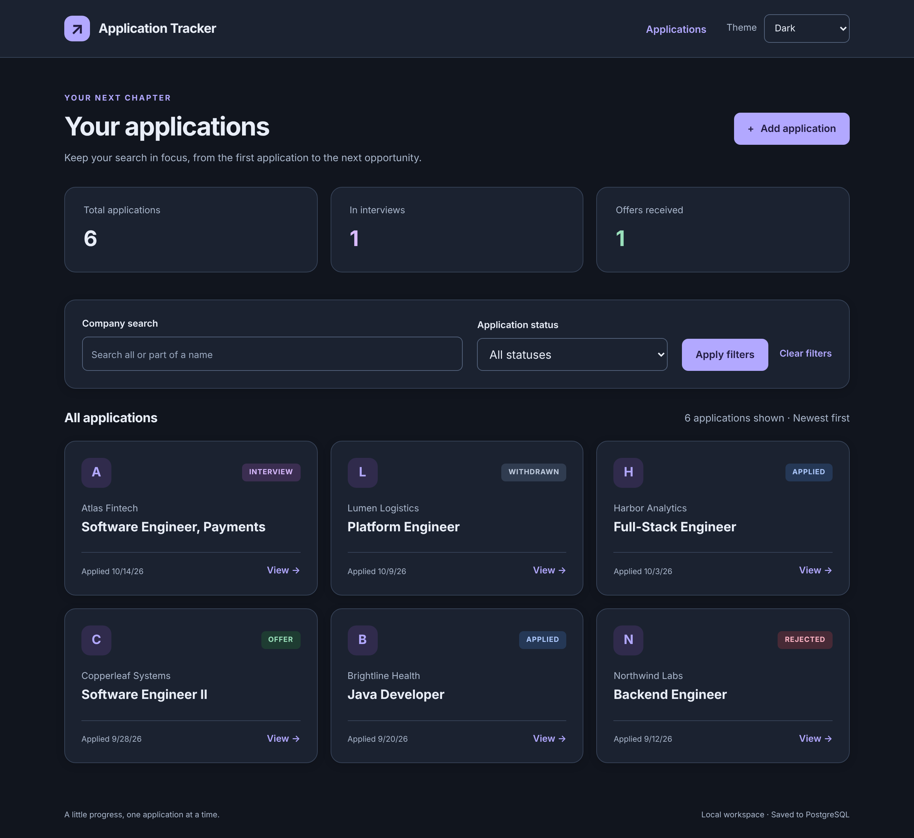
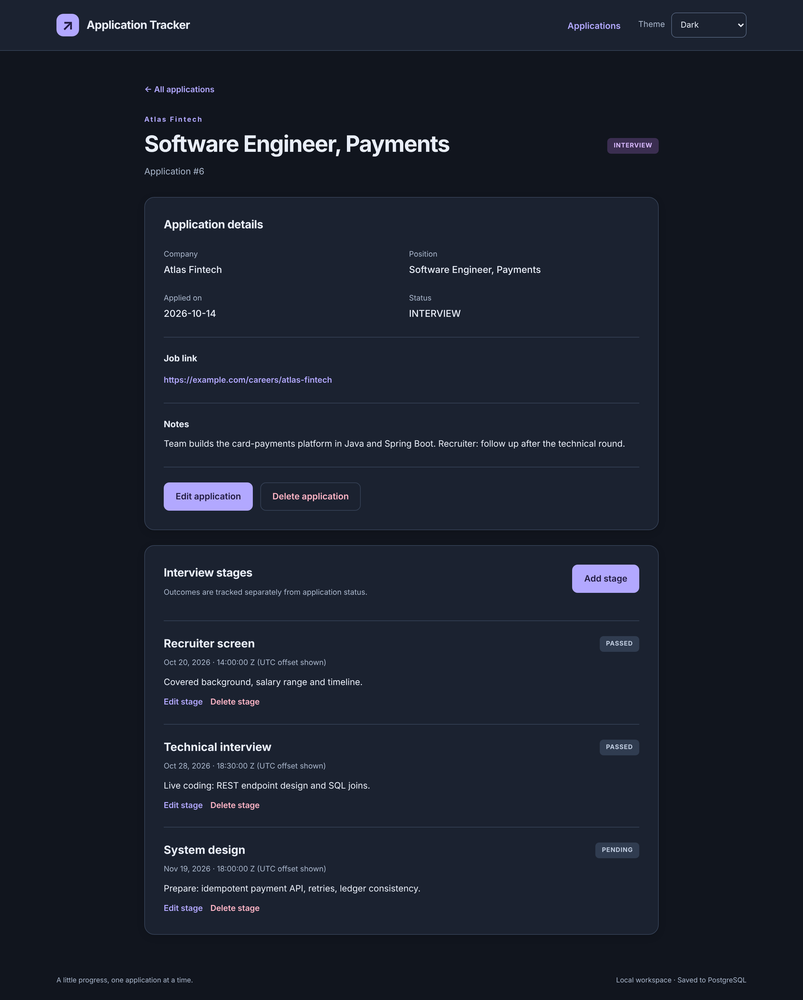
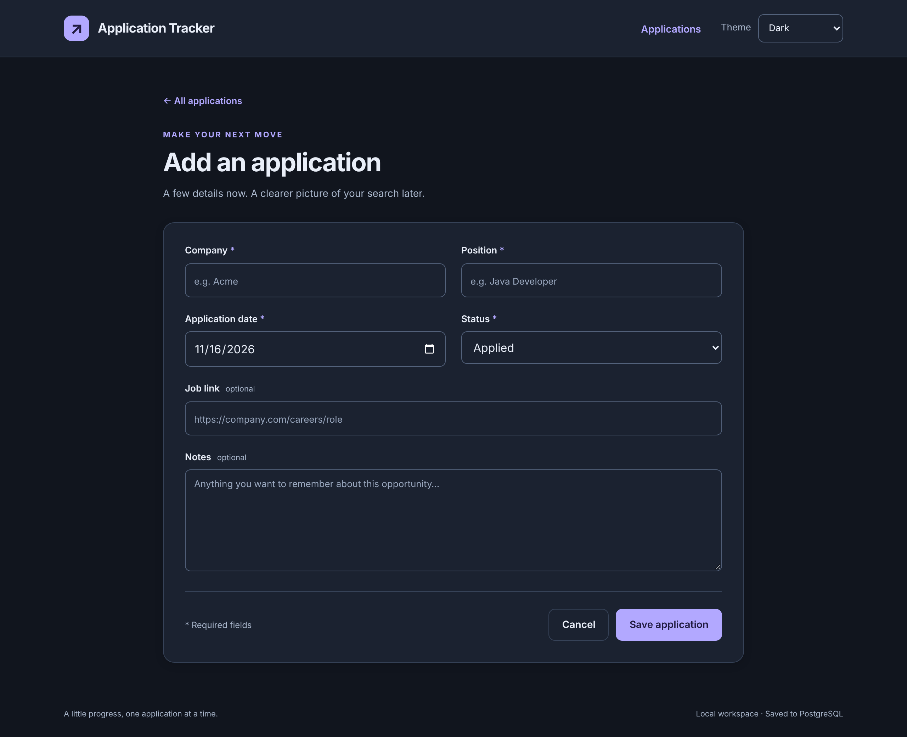
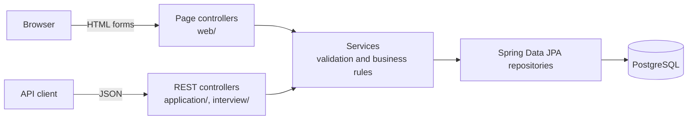

# Job Application Tracker

[](https://github.com/aalatraqchi/Job-App-Tracker/actions/workflows/ci.yml)


[](LICENSE)

A full-stack Java web application for tracking job applications from first submission through interviews to an offer. It has a server-rendered Thymeleaf interface and a JSON REST API, both built on the same service layer and persisted in PostgreSQL.



## Features

- **Application CRUD.** Record company, position, applied date, status, job URL and notes. Browse, edit and delete applications, with a confirmation step before anything is deleted.
- **Interview stages.** Attach any number of interview stages to an application, each with a scheduled time (time-zone aware), an outcome and notes. Deleting an application removes its stages.
- **Filtering and ordering.** Filter by status and by partial, case-insensitive company name, or combine both. Results are sorted newest first, and summary cards show totals, interviews and offers.
- **REST API.** The same operations are available as JSON endpoints, with consistent 400, 403 and 404 error bodies and field-level validation messages.
- **Request protection.** Spring Security CSRF protection covers every write, in both the HTML forms and the JSON API.
- **Backup and restore.** PowerShell scripts take checksummed `pg_dump` archives and restore them into a new, separate database, so a restore never overwrites live data. See [docs/backup-and-restore.md](docs/backup-and-restore.md).
- **Themes.** Five color themes (dark, light, ocean, forest and sunset), saved per browser.

| Application detail with interview stages | Add / edit form |
| --- | --- |
|  |  |

## Tech stack

| Layer | Technology |
| --- | --- |
| Language | Java 21 |
| Framework | Spring Boot 4.1 (Spring Web MVC, Spring Data JPA, Bean Validation, Spring Security) |
| UI | Thymeleaf, HTML, CSS and a little vanilla JavaScript |
| Database | PostgreSQL 17 (run with Docker Compose) |
| Testing | JUnit 5, Spring Boot Test, Testcontainers |
| Build and CI | Maven Wrapper, GitHub Actions |

## Architecture



The code is organized by feature rather than by layer:

```text
src/main/java/com/ashraf/jobapptracker/
├── application/   JobApplication entity, DTOs, service, repository and REST controller
├── interview/     InterviewStage entity, DTOs, service, repository and REST controller
├── web/           Thymeleaf page controllers and form objects
├── security/      CSRF and request-protection configuration
└── common/        Shared exception handling and URL validation
```

Design decisions worth noting:

- **One service layer for two front ends.** The page controllers and the REST controllers call the same services, so validation and business rules live in one place.
- **DTOs at the boundary.** Request and response records keep JPA entities out of the API, which makes the API contract explicit and easy to change.
- **Real-database tests.** Integration tests run against a disposable PostgreSQL container started by Testcontainers instead of an in-memory substitute. One test closes and reopens the Spring context to prove that data survives a restart.
- **Secure by default for local use.** The app and database bind to `127.0.0.1` only. Database credentials are generated locally and never committed.

## Getting started

### Prerequisites

- JDK 21
- Docker (Docker Desktop on Windows or macOS)

The Maven Wrapper downloads Maven on first use, so no separate Maven installation is needed.

### Run locally (macOS, Linux or Git Bash)

```bash
# 1. Create a local database password. .env is git-ignored.
echo "DB_PASSWORD=$(openssl rand -hex 32)" > .env

# 2. Start PostgreSQL on 127.0.0.1:5433
docker compose up -d --wait database

# 3. Start the app with the same password
export $(cat .env) && ./mvnw spring-boot:run
```

Then open <http://127.0.0.1:8080/>. The health check is at <http://127.0.0.1:8080/health>.

### Run locally (Windows PowerShell)

```powershell
.\scripts\setup-database.ps1   # generates local credentials and starts PostgreSQL
.\mvnw.cmd spring-boot:run
```

Windows also has one-click Start and Stop launchers that manage the app and database together. See [docs/windows-launcher.md](docs/windows-launcher.md).

### Configuration

| Environment variable | Default |
| --- | --- |
| `DB_URL` | `jdbc:postgresql://127.0.0.1:5433/job_app_tracker` |
| `DB_USERNAME` | `job_app_tracker` |
| `DB_PASSWORD` | No default. Read from the environment or from the ignored `application-local.properties` file. |

## Running the tests

```bash
./mvnw verify
```

Docker must be running. Testcontainers starts a throwaway PostgreSQL instance on a random port, so tests never touch your development data. The suite has 54 tests covering service rules, REST endpoints, Thymeleaf pages, validation, filtering, interview relationships, CSRF handling and persistence across restarts. GitHub Actions runs it on every push and pull request.

## REST API

| Method | Path | Description |
| --- | --- | --- |
| `GET` | `/applications?status=&company=` | List applications, optionally filtered |
| `POST` | `/applications` | Create an application (201) |
| `GET` | `/applications/{id}` | Get one application |
| `PUT` | `/applications/{id}` | Replace an application's details |
| `DELETE` | `/applications/{id}` | Delete an application and its interviews (204) |
| `GET` | `/applications/{id}/interviews` | List an application's interview stages |
| `POST` | `/applications/{id}/interviews` | Add an interview stage (201) |
| `PUT` | `/applications/{id}/interviews/{interviewId}` | Update an interview stage |
| `DELETE` | `/applications/{id}/interviews/{interviewId}` | Delete an interview stage (204) |
| `GET` | `/csrf` | Get a CSRF token for write requests |
| `GET` | `/health` | Health check |

Example request body for `POST /applications`:

```json
{
  "company": "Example Corp",
  "position": "Software Engineer",
  "appliedDate": "2026-10-08",
  "status": "APPLIED",
  "jobUrl": "https://example.com/careers/123",
  "notes": "Referred by a former colleague."
}
```

Write requests need a CSRF token. Call `GET /csrf`, keep the session cookie it returns, and send the token in the `X-CSRF-TOKEN` header. [docs/api-examples.md](docs/api-examples.md) walks through a complete create, update and delete flow.

## Roadmap

- [ ] User accounts with login and logout, and per-user ownership of applications
- [ ] Versioned schema migrations with Flyway, replacing `ddl-auto=update`
- [ ] Containerised deployment of the app itself

## License

[MIT](LICENSE)
