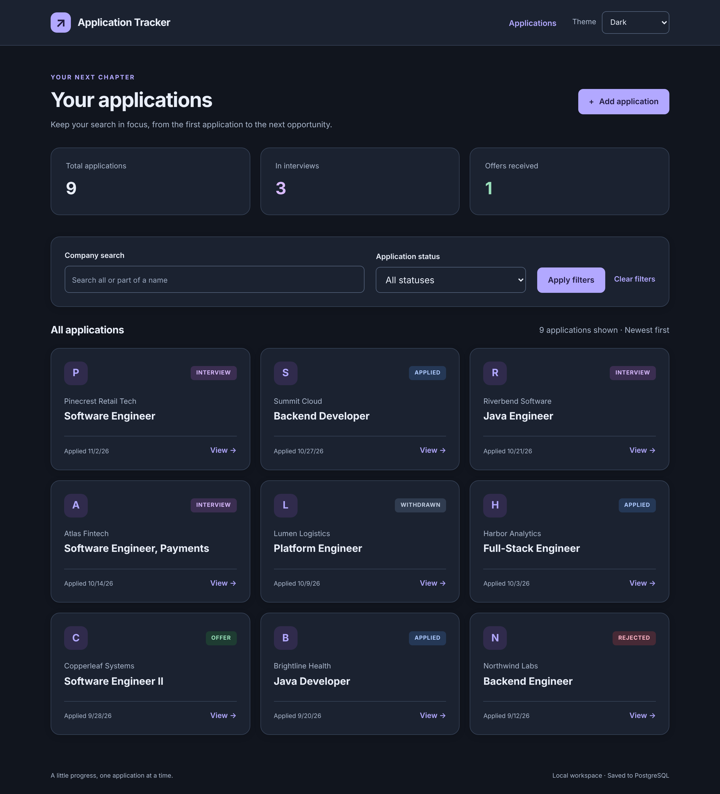
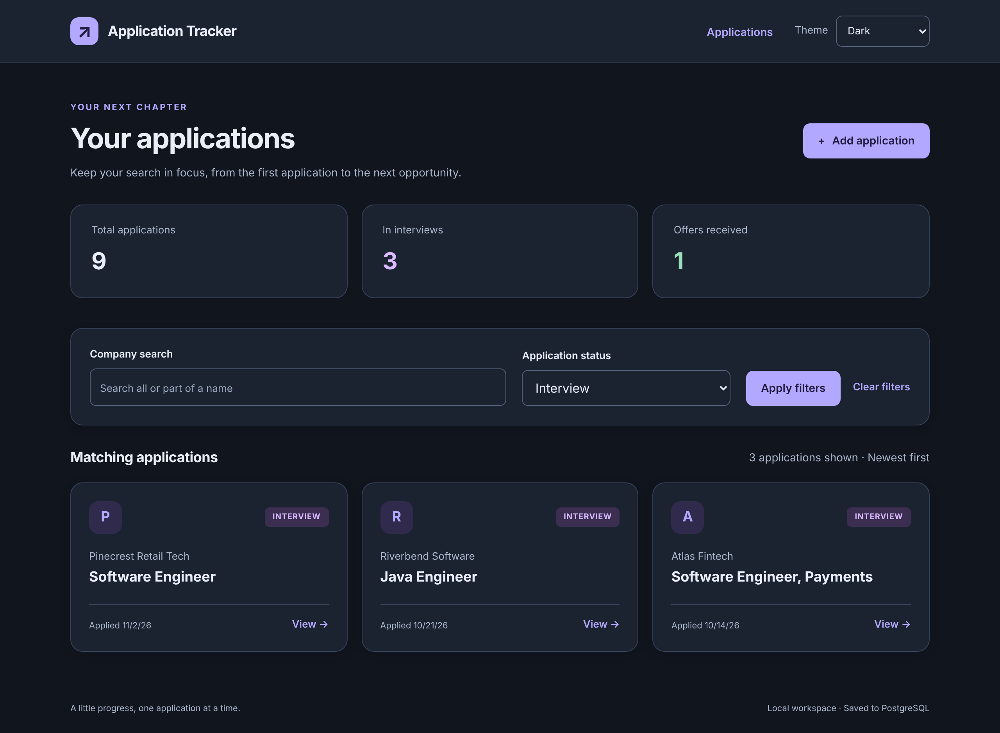

# Job Application Tracker

[](https://github.com/aalatraqchi/Job-App-Tracker/actions/workflows/ci.yml)
[](LICENSE)

A full-stack job application management system built with Java 21, Spring Boot, Thymeleaf, and PostgreSQL.

Track job applications, organize interview stages, monitor application progress, and manage records through a browser-based interface or REST API.



## Features

- **Application Management:** Create, view, update, and delete job applications.
- **Interview Tracking:** Manage interview stages, scheduled dates, outcomes, and notes for each application.
- **Dashboard:** View application statistics and monitor progress.
- **Search & Filtering:** Filter applications by company and application status.
- **REST API:** JSON endpoints for application and interview management.
- **Data Persistence:** PostgreSQL storage with verified persistence across application and database restarts.
- **Request Security:** CSRF protection for browser forms and API write requests.
- **Backup & Recovery:** Database backup and restore scripts.
- **Automated Testing:** 54 tests covering application behavior, validation, API requests, and database persistence.

## Tech Stack

- **Backend:** Java 21, Spring Boot
- **Frontend:** Thymeleaf, HTML, CSS, JavaScript
- **Database:** PostgreSQL
- **Testing:** JUnit, Spring Boot Test, Testcontainers
- **Build:** Maven
- **Environment:** Docker Compose

## Screenshots

| Filtered applications | Interview details |
| --- | --- |
|  |  |

## Getting Started

See [Setup Instructions](docs/SETUP.md) for prerequisites, database configuration, and instructions for running the application locally.

## Testing

Run the complete verification suite:

```bash
./mvnw verify
```

On Windows:

```powershell
.\mvnw.cmd verify
```

Docker Desktop must be running for the Testcontainers-based PostgreSQL tests.

## Current Scope

This version is designed for personal, single-user use. Account registration, authentication, and multi-user support are not currently implemented.

## Documentation

- [Setup Instructions](docs/SETUP.md): running locally, configuration, and the Windows desktop launcher
- [REST API](docs/API.md): endpoints, request bodies, errors, and CSRF tokens
- [Backup & Restore](docs/BACKUP-RESTORE.md): database backups and recovery
- [Architecture](docs/ARCHITECTURE.md): request flow, code layout, and design decisions

## License

[MIT](LICENSE)
