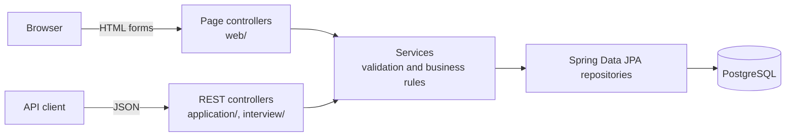

# Architecture

## Request flow



## Code layout

The code is organized by feature rather than by layer:

```text
src/main/java/com/ashraf/jobapptracker/
├── application/   JobApplication entity, DTOs, service, repository and REST controller
├── interview/     InterviewStage entity, DTOs, service, repository and REST controller
├── web/           Thymeleaf page controllers and form objects
├── security/      CSRF and request-protection configuration
└── common/        Shared exception handling and URL validation
```

## Design decisions

- **One service layer for two front ends.** The page controllers and the REST controllers call the same services, so validation and business rules live in one place.
- **DTOs at the boundary.** Request and response records keep JPA entities out of the API, which makes the API contract explicit and easy to change.
- **Real-database tests.** Integration tests run against a disposable PostgreSQL container started by Testcontainers instead of an in-memory substitute. One test closes and reopens the Spring context to prove that data survives a restart.
- **Secure by default for local use.** The app and database bind to `127.0.0.1` only. Database credentials are generated locally and never committed.

